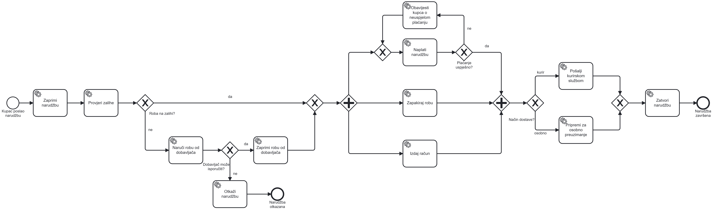

# Automatizacija i rudarenje procesa obrade narudžbe u web-trgovini

Prateći materijali seminarskog rada iz predmeta **Modeliranje, analiza i automatizacija poslovnih procesa**
(Sveučilište u Zagrebu, Fakultet elektrotehnike i računarstva, 2026.).

Repozitorij sadrži sve što je potrebno da se postupak iz rada ponovi od početka do kraja:

1. **model** procesa obrade narudžbe u notaciji BPMN 2.0, s tri ekskluzivna grananja, paralelnim dijelom s tri grane i petljom,
2. njegovu **automatizaciju** u sustavu Camunda 8,
3. **simulaciju** izvršavanja (300 instanci) i **izvoz loga** s redoslijedom izvršenih aktivnosti,
4. **rekonstrukciju procesa** iz loga u alatu ProM (Alpha, Heuristics i Inductive Miner),
5. **provjeru usklađenosti** rekonstruiranih modela s logom (fitness, preciznost, generalizacija).

Uz materijale su priložene i [vježbe](VJEZBE.md) koje nastavljaju na rad.



## Sadržaj repozitorija

| Mapa / datoteka | Sadržaj |
| --- | --- |
| [`bpmn/web_trgovina_c8.bpmn`](bpmn/web_trgovina_c8.bpmn) | Izvršni BPMN model za Camundu 8 (otvara se u Camunda Modeleru), uz sliku modela |
| [`skripte/simulacija.py`](skripte/simulacija.py) | Pokreće instance procesa i radi kao job worker (preko REST API-ja) |
| [`skripte/izvoz_loga.py`](skripte/izvoz_loga.py) | Izvozi povijest izvršavanja iz Camunde u CSV za ProM |
| [`podaci/`](podaci/) | Event log korišten u radu (CSV i XES) |
| [`prom/mreze/`](prom/mreze/) | Petrijeve mreže dobivene u ProM-u (PNML) |
| [`rezultati/`](rezultati/) | Sažetak rezultata iz rada |
| [`docs/UPUTE.md`](docs/UPUTE.md) | Detaljne upute korak po korak, s poznatim zamkama |
| [`VJEZBE.md`](VJEZBE.md) | Vježbe za samostalan rad |

## Brzi početak

Potrebno: **Camunda 8 Self-Managed** (lokalno, alat `c8run`, uz Javu 21+), **Camunda Desktop Modeler**,
**Python 3.10+** i **ProM 6.15**. Detaljne upute za instalaciju i svaki korak nalaze se u [`docs/UPUTE.md`](docs/UPUTE.md).

```bash
git clone <adresa-repozitorija>
cd camunda-process-mining-web-trgovina
python -m pip install -r requirements.txt
```

1. Pokrenite lokalnu Camundu 8 (`c8ctl cluster start 8.10`).
2. Otvorite `bpmn/web_trgovina_c8.bpmn` u Camunda Modeleru i deployajte ga na lokalni klaster.
3. Pokrenite simulaciju i izvezite log:

   ```bash
   python skripte/simulacija.py --instance 300 --seed 42
   python skripte/izvoz_loga.py
   ```

4. Uvezite `log_web_trgovina.csv` u ProM, pretvorite ga u XES i pokrenite algoritme (vidi [upute](docs/UPUTE.md#5-analiza-u-prom-u)).

Ako ne želite instalirati Camundu, analizu možete odmah početi od loga iz mape [`podaci/`](podaci/).

## Glavni rezultati

| Model | Fitness | Preciznost | Generalizacija |
| --- | --- | --- | --- |
| Inductive Miner (IM) | 1,000 | 0,722 | 0,993 |
| Alpha Miner | 0,91 | 0,869 | 0,991 |
| Heuristics Miner (pretvoren u Petrijevu mrežu) | 0,82 | 0,791 | 0,998 |

Inductive Miner jedini je dao ispravan (sound) model, ali pretjerano općenit. Alpha Miner nije otkrio petlju naplate,
a Heuristics Miner je otkrio sve konstrukte, no pretvorba u Petrijevu mrežu izgubila je paralelizam.
Detaljnije u [`rezultati/README.md`](rezultati/README.md) i u samom radu.

## Napomena o ponovljivosti

Log iz rada nastao je simulacijom bez fiksnog sjemena generatora slučajnih brojeva, pa nova simulacija daje
malo drukčije brojke. Za identične rezultate koristite priloženi log iz mape [`podaci/`](podaci/).
Skripta `simulacija.py` podržava parametar `--seed` za ponovljive nove simulacije.

## Autor

Ante Primorac, uz mentorstvo prof. dr. sc. Borisa Milašinovića.
